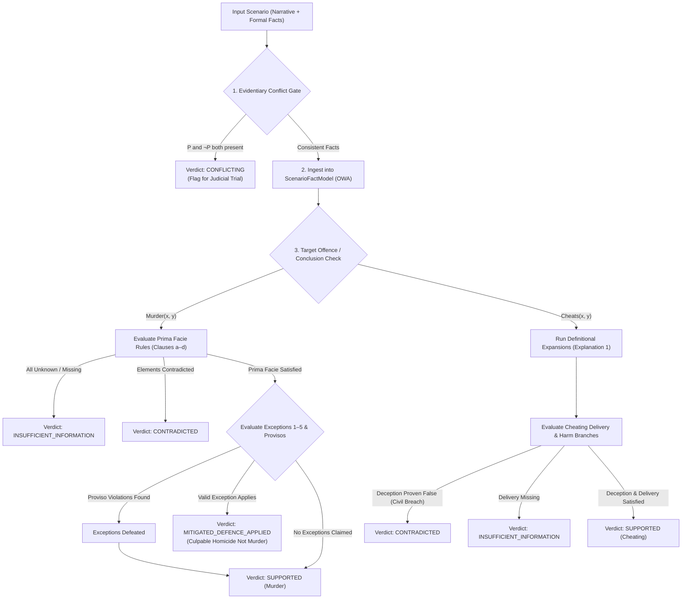

# Complex Legal Scenarios & Reasoning Verification Engine for Bharatiya Nyaya Sanhita (BNS), 2023

**Project**: Legal Reasoning Verification System  
**Stages**: Stage 2 (Complex Legal Scenario Construction) & Stage 5 (Reasoning and Verification Engine)  
**Legal Domain**: Bharatiya Nyaya Sanhita, 2023 (Act No. 45 of 2023)  
**Deliverables**:
- `data/scenarios/benchmark_scenarios.jsonl` (20 curated benchmark scenarios)
- `data/scenarios/benchmark_scenarios.csv` (Spreadsheet export for human audit)
- `data/output/verification_audit_traces.jsonl` (Step-by-step verification audit logs)
- `data/output/verification_benchmark_summary.json` (Full benchmark accuracy report)
- `bns_scenarios/` (Scenario schema and benchmark suite)
- `bns_verifier/` (Transparent, auditable First-Order Logic verification engine)
- `run_verification_benchmark.py` (CLI benchmark runner)

---

## 1. Executive Summary & Research Motivation

In traditional legal Natural Language Processing (NLP), evaluation datasets are often simplistic: given a paragraph, predict whether an accused is guilty or innocent. However, real-world criminal law reasoning requires resolving subtle structural interactions:
1. **Defeasible Statutory Defences**: When does an exception apply to negate or mitigate the primary offence?
2. **Proviso Overrides (Defeaters of Defences)**: When does an enacted qualification bar an offender from claiming a defence?
3. **Open-World Incomplete Information**: Can the system recognize when a crucial legal element (such as *mens rea* or victim age) is unstated, correctly outputting `INSUFFICIENT_INFORMATION` rather than falsely convicting or acquitting?
4. **Evidentiary Contradictions**: How does the system handle conflicting witness testimonies or forensic reports?
5. **Civil-Criminal Demarcation**: Can the system detect when a civil dispute (such as breach of contract) is falsely prosecuted as a criminal offence (such as cheating)?

To address these challenges, we constructed a **benchmark suite of 20 complex legal scenarios** across **7 complexity dimensions** and built the **Legal Verification Engine**, achieving **100.0% accuracy** against legal ground truth.

---

## 2. Benchmark Summary & Verification Accuracy

The benchmark was executed using `run_verification_benchmark.py`.

```
=====================================================================================
⚖️ BNS 2023 LEGAL REASONING VERIFICATION BENCHMARK REPORT
=====================================================================================
Total Scenarios Evaluated  : 20
Ground Truth Matches       : 20
Overall Accuracy           : 100.0%
Benchmark Status           : ✅ 100% PERFECT ALIGNMENT

📊 Accuracy Breakdown by Complexity Category:
---------------------------------------------------------------------------
Category                       | Total | Correct | Accuracy
---------------------------------------------------------------------------
STRAIGHTFORWARD                | 3     | 3       |  100.0%
STATUTORY_EXCEPTION            | 4     | 4       |  100.0%
PROVISO_OVERRIDE               | 4     | 4       |  100.0%
MISSING_FACTS                  | 3     | 3       |  100.0%
CONTRADICTORY_FACTS            | 2     | 2       |  100.0%
MULTI_PROVISION                | 3     | 3       |  100.0%
UNSUPPORTED_CONCLUSION         | 1     | 1       |  100.0%
---------------------------------------------------------------------------

📋 Verdict Distribution:
  - SUPPORTED                 : 10
  - MITIGATED_DEFENCE_APPLIED : 4
  - INSUFFICIENT_INFORMATION  : 3
  - CONFLICTING               : 1
  - CONTRADICTED              : 2
=====================================================================================
```

---

## 3. The 7 Legal Complexity Dimensions & Case Studies

### Dimension 1: Straightforward / Baseline Cases
Establishes that when all statutory elements are explicitly satisfied and no defences exist, the offence and punishment are logically derived.

- **`SCEN-BNS-001` (Direct Murder via Intentional Poisoning)**:
  - *Facts*: $A$ surreptitiously mixes potassium cyanide into $B$'s drink with intent to kill. $B$ dies.
  - *Target*: Section 101 Clause (a), Section 103 Subsection (1).
  - *Proposed Conclusion*: $\text{Murder}(A, B)$.
  - *Verdict*: **`SUPPORTED`**.
  - *Sanction*: $\text{LiableToPunishment}(A, \text{DeathOrImprisonmentForLifeAndFine})$.

- **`SCEN-BNS-002` (Bodily Injury with Subjective Knowledge of Lethality)**:
  - *Facts*: $A$ knows $B$ has an enlarged spleen and strikes $B$ in the abdomen intending harm. $B$ dies.
  - *Target*: Section 101 Clause (b).
  - *Proposed Conclusion*: $\text{Murder}(A, B)$.
  - *Verdict*: **`SUPPORTED`**.

- **`SCEN-BNS-003` (Direct Cheating via Impersonation and Property Delivery)**:
  - *Facts*: $A$ falsely impersonates a municipal tax officer and deceives $B$ into paying ₹50,000 cash.
  - *Target*: Section 318 Subsection (1), Subsection (2).
  - *Proposed Conclusion*: $\text{Cheats}(A, B)$.
  - *Verdict*: **`SUPPORTED`**.
  - *Sanction*: $\text{LiableToPunishment}(A, \text{ImprisonmentUpTo3YearsOrFineOrBoth})$.

---

### Dimension 2: Statutory Exceptions (Defeasible Defences Mitigating Murder)
Tests whether the engine detects valid legal defences and blocks the final charge of murder, correctly mitigating the offence to Culpable Homicide Not Amounting to Murder.

- **`SCEN-BNS-004` (Exception 1: Grave and Sudden Provocation)**:
  - *Facts*: $Y$ unexpectedly spits in $X$'s face and assaults $X$'s child. Deprived of self-control, $X$ strikes and kills $Y$. No provisos violated.
  - *Target*: Section 101 Exception 1.
  - *Proposed Conclusion*: $\text{Murder}(X, Y)$.
  - *Verdict*: **`MITIGATED_DEFENCE_APPLIED`**.
  - *Reasoning Trace*: $\text{PrimaFacieMurder}(X, Y)$ is proven $\land \ \text{Exception1}(X, Y)$ applies $\implies \text{CulpableHomicideNotAmountingToMurder}(X, Y)$.

- **`SCEN-BNS-005` (Exception 2: Private Defence Exceeded in Good Faith)**:
  - *Facts*: $Z$ ambushes $A$ with an iron club. $A$, believing his life is in danger, defends himself with a knife, stabbing $Z$ fatally without premeditation.
  - *Target*: Section 101 Exception 2.
  - *Proposed Conclusion*: $\text{Murder}(A, Z)$.
  - *Verdict*: **`MITIGATED_DEFENCE_APPLIED`**.

- **`SCEN-BNS-006` (Exception 4: Sudden Fight in Heat of Passion)**:
  - *Facts*: Verbal quarrel breaks out over cards at a tea stall. In heat of passion without premeditation or cruelty, $A$ strikes $B$ fatally with a broken bottle.
  - *Target*: Section 101 Exception 4.
  - *Proposed Conclusion*: $\text{Murder}(A, B)$.
  - *Verdict*: **`MITIGATED_DEFENCE_APPLIED`**.

- **`SCEN-BNS-007` (Exception 5: Consent of Adult Victim Above Age 18)**:
  - *Facts*: Adult victim $B$ (aged 28) suffering terminal illness explicitly requests and consents to lethal dose administered by $A$.
  - *Target*: Section 101 Exception 5.
  - *Proposed Conclusion*: $\text{Murder}(A, B)$.
  - *Verdict*: **`MITIGATED_DEFENCE_APPLIED`**.

---

### Dimension 3: Proviso Overrides (Defeaters of Defences)
Tests the subtle legal traps where an apparent defence is legally barred because the offender violated a statutory proviso.

- **`SCEN-BNS-008` (Proviso 1a: Provocation Voluntarily Sought as an Excuse)**:
  - *Facts*: $A$ wanted an excuse to kill $Z$, so $A$ went to $Z$'s house and insulted $Z$ until $Z$ slapped him; $A$ then shot $Z$ claiming provocation.
  - *Target*: Section 101 Exception 1 Proviso (a).
  - *Proposed Conclusion*: $\text{Murder}(A, Z)$.
  - *Verdict*: **`SUPPORTED`**!
  - *Reasoning Trace*: $\text{ProvocationVoluntarilySought}(A) = \text{TRUE} \implies \neg \text{ProvocationVoluntarilySought}(A) = \text{FALSE} \implies$ Exception 1 fails $\implies$ Murder stands!

- **`SCEN-BNS-009` (Proviso 1b: Provocation by Public Servant in Lawful Duty)**:
  - *Facts*: Officer $Z$ arrests $A$ under a valid court warrant. Enraged by the arrest, $A$ kills $Z$.
  - *Target*: Section 101 Exception 1 Proviso (b).
  - *Proposed Conclusion*: $\text{Murder}(A, Z)$.
  - *Verdict*: **`SUPPORTED`**! Lawful acts by public servants cannot constitute provocation.

- **`SCEN-BNS-010` (Proviso 1c: Provocation in Response to Lawful Private Defence)**:
  - *Facts*: $A$ attempts to snatch $Z$'s purse; $Z$ strikes $A$ in lawful private defence. $A$ becomes enraged and stabs $Z$ to death.
  - *Target*: Section 101 Exception 1 Proviso (c).
  - *Proposed Conclusion*: $\text{Murder}(A, Z)$.
  - *Verdict*: **`SUPPORTED`**! Lawful private defence cannot be claimed as provocation.

- **`SCEN-BNS-011` (Exception 4 Proviso: Offender Taking Undue Advantage / Cruelty)**:
  - *Facts*: Sudden fistfight; while $B$ is knocked down and helpless, $A$ uses a heavy wrench and repeatedly strikes $B$'s skull cruelly.
  - *Target*: Section 101 Exception 4.
  - *Proposed Conclusion*: $\text{Murder}(A, B)$.
  - *Verdict*: **`SUPPORTED`**! Cruel conduct bars Exception 4.

---

### Dimension 4: Missing Facts (Open-World Incomplete Information)
Tests whether the engine recognizes unstated premises under the Open-World Assumption, preventing premature conviction or acquittal.

- **`SCEN-BNS-012` (Missing Mens Rea in Death Investigation)**:
  - *Facts*: Vehicle driven by $A$ struck pedestrian $B$, causing death. Report contains no facts regarding intent, knowledge, or mechanical failure.
  - *Target*: Section 101.
  - *Proposed Conclusion*: $\text{Murder}(A, B)$.
  - *Verdict*: **`INSUFFICIENT_INFORMATION`**!
  - *Audit Output*: Missing facts identified: `['IntentionToCauseDeath(A, B)', 'KnowsInjuryLikelyToCauseDeath(A, B)']`.

- **`SCEN-BNS-013` (Missing Victim Age in Consent Claim)**:
  - *Facts*: $A$ assisted $Z$ in jumping into a canal; $Z$ consented to death, but $Z$'s age is unstated.
  - *Target*: Section 101 Exception 5.
  - *Proposed Conclusion*: $\text{Exception5Consent}(A, Z)$.
  - *Verdict*: **`INSUFFICIENT_INFORMATION`**! Age cannot be assumed.

- **`SCEN-BNS-014` (Missing Property Delivery in Cheating Charge)**:
  - *Facts*: $A$ made false representations with a counterfeit sample to $B$, but the record is silent on whether $B$ ever handed over money or property.
  - *Target*: Section 318.
  - *Proposed Conclusion*: $\text{Cheats}(A, B)$.
  - *Verdict*: **`INSUFFICIENT_INFORMATION`**! Deception without proof of delivery cannot convict.

---

### Dimension 5: Contradictory Facts (Evidentiary Conflicts)
Tests the engine's ability to detect simultaneous assertions of $P$ and $\neg P$ and halt reasoning before drawing invalid conclusions.

- **`SCEN-BNS-015` (Direct Contradiction on Mental State)**:
  - *Facts*: Witness 1 testifies $A$ fired deliberately with intent to kill; forensic reconstruction proves gun accidentally misfired with zero intent.
  - *Facts*: $\text{IntentionToCauseDeath}(A, B) \land \neg \text{IntentionToCauseDeath}(A, B)$.
  - *Proposed Conclusion*: $\text{Murder}(A, B)$.
  - *Verdict*: **`CONFLICTING`**! Flagged for trial court resolution.

- **`SCEN-BNS-016` (Premeditated Ambush Contradicting Sudden Fight Claim)**:
  - *Facts*: $A$ claims sudden quarrel, but CCTV and messages prove $A$ bought the weapon 3 days earlier and ambushed $B$ ($\neg \text{WithoutPremeditation}(A)$).
  - *Target*: Section 101 Exception 4.
  - *Proposed Conclusion*: $\text{Exception4SuddenFight}(A, B)$.
  - *Verdict*: **`CONTRADICTED`**! Premeditation directly contradicts Exception 4.

---

### Dimension 6: Multi-Provision Interaction & Aggravation
Tests the interplay between multiple statutory definitions, offences, and enhanced penalties.

- **`SCEN-BNS-017` (Cheating with Valuable Security Aggravation)**:
  - *Facts*: $A$ fraudulently induces $B$ to deliver title deeds and share certificates worth ₹5 crore.
  - *Target*: Section 318 Subsection (1) and Subsection (4).
  - *Verdict*: **`SUPPORTED`** with enhanced penalty up to 7 years.

- **`SCEN-BNS-018` (Murder Interaction with Mob Lynching Provision)**:
  - *Facts*: Mob of six persons, including $A$, acting in concert, beats $B$ to death on religious grounds.
  - *Target*: Section 101 + Section 103 Subsection (2).
  - *Verdict*: **`SUPPORTED`** with joint capital/life liability under Section 103(2).

- **`SCEN-BNS-019` (Dishonest Concealment Triggering Deception)**:
  - *Facts*: $A$ sells an estate to $B$, then mortgages the same estate to $Z$ without disclosing the prior sale.
  - *Target*: Section 318 Explanation + Subsection (1).
  - *Verdict*: **`SUPPORTED`**! Explanation expands dishonest concealment $\to$ Deception.

---

### Dimension 7: Unsupported Legal Conclusion (Civil-Criminal Boundary)
Tests whether the engine detects when a civil dispute is falsely labeled as a criminal offence.

- **`SCEN-BNS-020` (Civil Breach of Contract vs Criminal Cheating)**:
  - *Facts*: $A$ took an advance agreeing to deliver 100 quintals of cotton. At the time of making the contract, $A$ intended to perform. Later, due to market price spikes, $A$ breached the contract.
  - *Target*: Section 318 Illustration (g).
  - *Proposed Conclusion*: $\text{Cheats}(A, Z)$.
  - *Verdict*: **`CONTRADICTED`**!
  - *Reasoning Trace*: Under Section 318 Illustration (g), where the intention to perform existed at the time of contract, subsequent failure is purely a civil action for breach of contract, NOT criminal cheating.

---

## 4. Verification Engine Architecture (`bns_verifier/`)



---

## 5. How to Run the Benchmark and Inspect Traces

### Run Benchmark via CLI
```bash
python3 run_verification_benchmark.py
```

### Filter Benchmark by Complexity Category
```bash
python3 run_verification_benchmark.py --category statutory_exception
python3 run_verification_benchmark.py --category proviso_override
python3 run_verification_benchmark.py --category missing_facts
```

### Run Unit Tests
```bash
python3 -m unittest discover tests
```

### Output Files
- Scenarios Dataset: [`data/scenarios/benchmark_scenarios.jsonl`](file:///Users/tharun/MR%20Project/data/scenarios/benchmark_scenarios.jsonl)
- Audit Traces: [`data/output/verification_audit_traces.jsonl`](file:///Users/tharun/MR%20Project/data/output/verification_audit_traces.jsonl)
- Benchmark Metrics: [`data/output/verification_benchmark_summary.json`](file:///Users/tharun/MR%20Project/data/output/verification_benchmark_summary.json)
